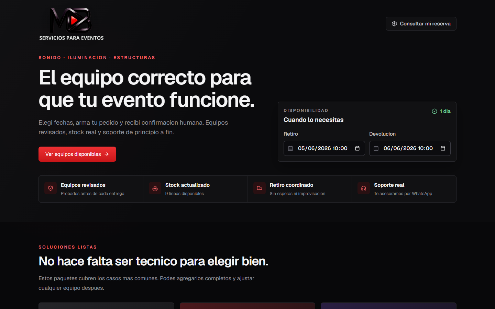
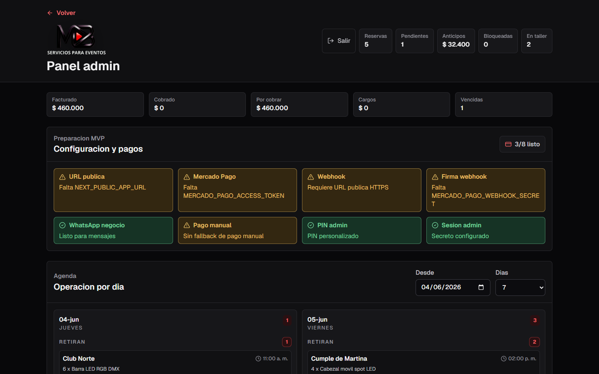
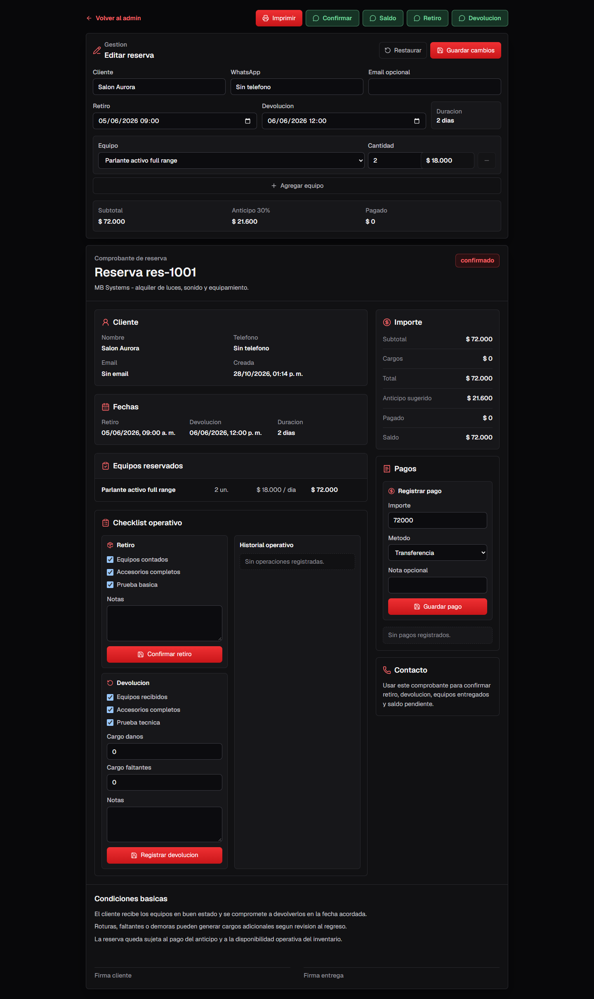
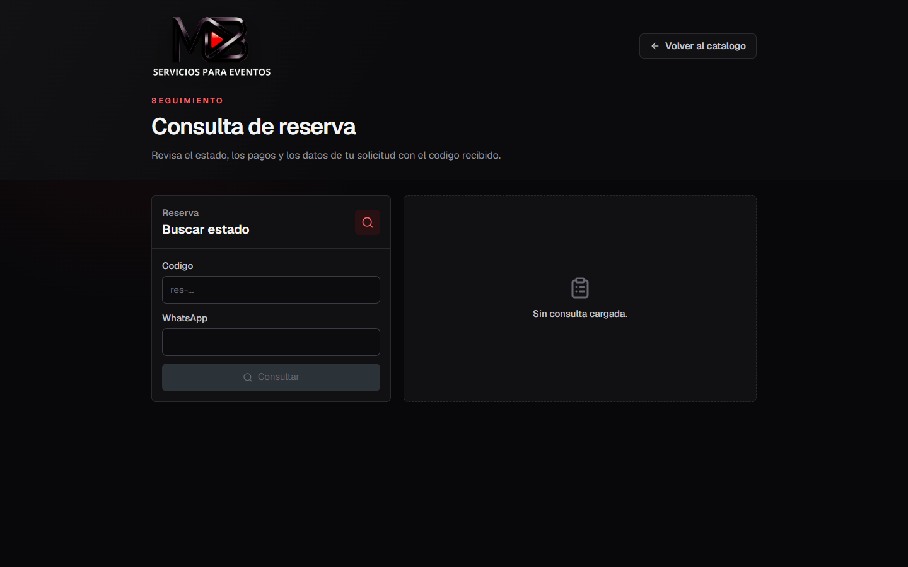
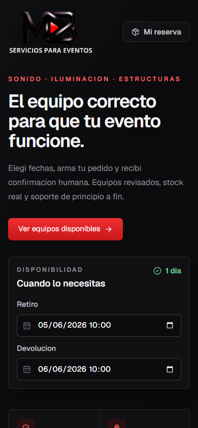

# MB Systems

Sistema web de **alquiler y reservas de equipamiento para eventos** (sonido, iluminación y estructuras). Cubre el ciclo completo de una reserva: catálogo público con disponibilidad por fechas, pedido online, panel administrativo, cobros (manuales y Mercado Pago), checklist de retiro y devolución, y bloqueos de inventario por mantenimiento.

Lo desarrollé para un negocio real de alquiler de equipos (MB Servicios para Eventos), reemplazando un flujo manual de WhatsApp + planillas.



## Stack

| Capa | Tecnología |
| --- | --- |
| Framework | Next.js 16 (App Router, Route Handlers) |
| UI | React 19, Tailwind CSS 4, lucide-react |
| Lenguaje | TypeScript 5 (strict) |
| Persistencia | SQLite con `better-sqlite3` (modo WAL, transacciones síncronas) |
| Pagos | Mercado Pago Checkout Pro (preferencias + webhook firmado) |
| Calidad | ESLint 9 (`eslint-config-next`) |

## Funcionalidades

**Cliente (público)**
- Catálogo con filtros y stock disponible calculado en vivo para la ventana retiro → devolución elegida.
- Paquetes armados ("soluciones listas") que se agregan completos al pedido.
- Alta de reserva con cálculo automático de subtotal y **anticipo del 30%**.
- Consulta de reserva por código y teléfono, con botón de pago y contacto por WhatsApp.

**Administración** (protegida por PIN + cookie de sesión firmada)
- Tablero con métricas: facturado, cobrado, por cobrar, cargos, reservas vencidas, unidades en taller.
- Agenda operativa por día (retiros y devoluciones).
- Edición de reservas con revalidación de stock.
- Registro de pagos (efectivo, transferencia, Mercado Pago, tarjeta) y saldo.
- Checklist de **retiro** y **devolución**, con cargos por daños o faltantes e historial operativo.
- Bloqueos de inventario (mantenimiento/taller) que descuentan stock por rango de fechas.
- Comprobante imprimible y mensajes prearmados de WhatsApp (confirmación, saldo, retiro, devolución).
- Panel de "preparación" que verifica qué variables de entorno de producción faltan.

## Capturas

| Panel admin | Detalle de reserva |
| --- | --- |
|  |  |

| Consulta de reserva | Mobile |
| --- | --- |
|  |  |

Las capturas se tomaron con la base de datos de ejemplo que genera la app (`seedProducts` / `seedBookings`); no contienen datos de clientes reales.

## Arquitectura

```
src/
├── app/
│   ├── page.tsx                  # Catálogo público
│   ├── reservas/page.tsx         # Consulta de reserva
│   ├── admin/                    # Panel (layout protegido, login, detalle de reserva)
│   └── api/                      # Route Handlers (REST)
├── components/                   # Workspaces de cliente y admin, formularios
└── lib/
    ├── rental-db.ts              # Acceso a datos, esquema y reglas de negocio
    ├── rental-data.ts            # Tipos de dominio, estados y cálculo de disponibilidad
    ├── admin-auth.ts             # Sesión admin (HMAC-SHA256, comparación en tiempo constante)
    ├── request-security.ts       # Chequeo de origen (CSRF) y rate limiting
    ├── mercado-pago.ts           # Preferencias y validación de firma del webhook
    └── system-status.ts          # Diagnóstico de configuración de producción
```

### Modelo de datos

```
products ──< booking_items >── bookings ──< booking_payments ──< booking_payment_sources
                                   │
                                   └──< booking_operations   (retiro / devolución / cargos)
products ──< inventory_blocks                                  (mantenimiento por fechas)
```

Índices sobre `bookings(start_at, end_at, status)` y `inventory_blocks` para que la consulta de disponibilidad por ventana de fechas no recorra toda la tabla.

### Ciclo de vida de una reserva

```
pendiente ──> confirmado ──> pagado ──> retirado ──> devuelto
     └──────────────┴────────────┴──> cancelado
```

Las transiciones se aplican en el servidor: registrar un pago puede pasar la reserva de `pendiente` a `confirmado`/`pagado`, y las operaciones de retiro y devolución actualizan el estado y el historial.

### Decisiones relevantes

- **Disponibilidad calculada, no almacenada.** El stock libre de un producto es `total − en taller − reservado en ventanas solapadas`. Se calcula en cada consulta en lugar de mantener contadores, lo que evita inconsistencias al editar o cancelar reservas.
- **Validación de stock dentro de una transacción.** Crear o editar una reserva, registrar un pago o bloquear inventario se hace dentro de `db.transaction(...)`. `better-sqlite3` es síncrono, así que la verificación de stock y la escritura no se intercalan con otra request: no se pueden sobrevender unidades.
- **SQLite en modo WAL.** Para el volumen de un negocio chico alcanza y simplifica el despliegue (un archivo, sin servidor de base). Lecturas concurrentes sin bloquear la escritura.
- **Lógica de negocio en `lib/`, no en los handlers.** Los Route Handlers solo validan la entrada, aplican seguridad y delegan; las reglas viven en un único módulo testeable.

## API

| Método | Ruta | Acceso | Descripción |
| --- | --- | --- | --- |
| GET | `/api/rentals?start=&end=` | Público | Catálogo con unidades disponibles en la ventana |
| POST | `/api/bookings` | Público (8 cada 10 min por IP) | Crear reserva |
| POST | `/api/public-bookings/lookup` | Público (rate limit) | Consultar reserva por código + teléfono |
| POST | `/api/mercadopago/preferences` | Público (rate limit) | Crear preferencia de pago para el anticipo o saldo |
| POST | `/api/mercadopago/webhook` | Mercado Pago | Notificación de pago (firma HMAC verificada) |
| GET | `/api/bookings` | Admin | Listado de reservas |
| PATCH | `/api/bookings/{id}` | Admin | Editar reserva (revalida stock) |
| POST | `/api/bookings/{id}/payments` | Admin | Registrar pago |
| POST | `/api/bookings/{id}/operations` | Admin | Registrar retiro o devolución |
| POST / PATCH | `/api/products`, `/api/products/{id}` | Admin | Alta y edición de productos |
| GET / POST / DELETE | `/api/inventory-blocks[/{id}]` | Admin | Bloqueos de inventario |
| GET / POST / DELETE | `/api/admin/session` | — | Estado, login y logout de la sesión admin |

Ejemplo de alta de reserva:

```http
POST /api/bookings
Content-Type: application/json

{
  "customer": { "name": "Cliente Demo", "phone": "5491100000000", "email": "" },
  "start": "2026-06-05T10:00",
  "end": "2026-06-06T10:00",
  "items": [{ "productId": "pa-speaker-15", "quantity": 2 }]
}
```

Si alguna línea no tiene stock suficiente, la API responde con un error que indica el producto (`"<producto> no tiene stock suficiente para esas fechas."`) y no se escribe nada.

## Seguridad

Hice una revisión de seguridad del MVP y apliqué las correcciones; el detalle está en [`docs/security-review.md`](docs/security-review.md).

- Chequeo de `Origin`/`Referer` en todos los endpoints que modifican estado (defensa CSRF).
- Rate limiting en los endpoints públicos (alta, consulta y pago).
- Cabeceras de seguridad globales, incluida Content-Security-Policy.
- Sesión admin firmada con HMAC-SHA256 y comparación en tiempo constante (`timingSafeEqual`).
- En producción no hay credenciales por defecto, y el webhook de Mercado Pago rechaza notificaciones sin firma válida.
- Validación del destino de redirección del checkout.

Riesgos aceptados y documentados para el MVP: autenticación admin solo por PIN, rate limit en memoria (no compartido entre instancias) y base en archivo local.

## Ejecutar localmente

Requisitos: Node.js 20+ y npm.

```bash
npm ci
cp .env.example .env.local   # completar valores
npm run dev                  # http://localhost:3000
```

La base `data/mb-systems.sqlite` se crea sola en el primer arranque y se carga con productos y reservas de ejemplo.

```bash
npm run lint     # ESLint
npm run build    # build de producción
npm start
```

### Variables de entorno

| Variable | Uso | Obligatoria en producción |
| --- | --- | --- |
| `ADMIN_PIN` | PIN del panel admin | Sí |
| `ADMIN_SESSION_SECRET` | Secreto para firmar la cookie de sesión | Sí |
| `NEXT_PUBLIC_APP_URL` | URL pública (retorno del checkout y webhook) | Sí, para Mercado Pago |
| `NEXT_PUBLIC_BUSINESS_WHATSAPP` | Número para los mensajes al cliente | Sí |
| `NEXT_PUBLIC_PAYMENT_ALIAS` / `_CBU` / `_HOLDER` / `_LINK` | Datos para pago manual | No |
| `MERCADO_PAGO_ACCESS_TOKEN` | Token de Mercado Pago | Para cobros online |
| `MERCADO_PAGO_ENV` | `sandbox` o `production` | Para cobros online |
| `MERCADO_PAGO_WEBHOOK_SECRET` | Validación de firma del webhook | Para cobros online |

## Verificación

Verificado el 28/10/2026 sobre una copia limpia del repositorio:

- `npm run build`: compila sin errores.
- `npm run lint`: sin observaciones.
- Recorrido manual: catálogo, consulta de reserva, login admin, tablero y detalle de reserva (de ahí salen las capturas).

El proyecto todavía no tiene tests automatizados. Lo siguiente sería cubrir con tests la función de disponibilidad y las transiciones de estado.

## Showcase estático

La rama `gh-pages` tiene una exportación estática solo visual del catálogo, pensada para mostrársela al cliente: los filtros y el carrito funcionan en el navegador, y las reservas, el panel y los pagos están deshabilitados.

## Documentación adicional

- [`docs/security-review.md`](docs/security-review.md): hallazgos de seguridad, correcciones y riesgos aceptados.
- [`docs/technical-benchmark.md`](docs/technical-benchmark.md): comparación con software especializado (Booqable, Rentman, Current RMS) y brechas del MVP.
- [`docs/market-study.md`](docs/market-study.md): estudio de mercado del rubro.

## Próximos pasos

- Tests automatizados de disponibilidad y estados.
- Autenticación admin con usuarios y roles (reemplazar el PIN).
- Rate limiting distribuido (Redis) para desplegar varias instancias.
- Migración a PostgreSQL si crece el volumen de operaciones.

## Licencia

Código propietario, desarrollado para MB Servicios para Eventos. Todos los derechos reservados. Las fotos del catálogo son ilustrativas.
